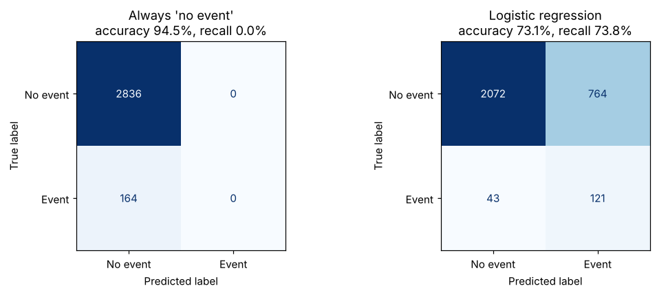

# Why 95% accuracy can be useless

A short, reproducible example of **class imbalance** in rare-event prediction, such as adverse events in clinical studies or large claims in insurance.

## The point in one table

On a synthetic dataset with a 5.5% event rate (3,000 test records, 164 events):

| Model | Accuracy | Events caught | False alarms | Cost (illustrative) |
| --- | --- | --- | --- | --- |
| Always predict "no event" | 94.5% | 0 of 164 | 0 | 1,640 |
| Logistic regression, threshold 0.5 | 73.1% | 121 of 164 | 764 | 1,194 |
| Logistic regression, threshold 0.65 (tuned on validation) | 86.3% | 86 of 164 | 333 | 1,113 |

The baseline has the highest accuracy and the highest cost. Cost assumes a missed event is 10 times as costly as a false alarm.

## What the notebook covers

1. Building a rare-event dataset with stratified train, validation and test sets
2. A majority-class baseline that scores high accuracy and catches nothing
3. A class-weighted logistic regression compared on accuracy, recall, precision and F1
4. Precision-recall curve and average precision, compared against the event rate
5. Choosing a decision threshold from the cost of each type of error, tuned on validation and reported once on test

## Data and assumptions

- All data is **synthetic**, generated with `sklearn.datasets.make_classification`. It does not represent any real patients, study or organisation.
- The 10:1 cost of a missed event versus a false alarm is an **illustrative assumption**, not a real-world figure.

## Author

Yuktha, research ethics and health data science. (https://www.linkedin.com/in/yukthashreenivasan/)
